# Weather Intelligence

**A conversational travel assistant that turns weather forecasts into trip decisions.**

[](https://github.com/rniyati07/weather-intelligence/actions/workflows/ci.yml)


[](LICENSE)

Describe a trip in plain language and get an answer instead of a raw forecast: how suitable your dates are, the best day, the day to watch out for, a day-by-day breakdown and what to pack. The conversation remembers the trip, so follow-up questions never need the details repeated.

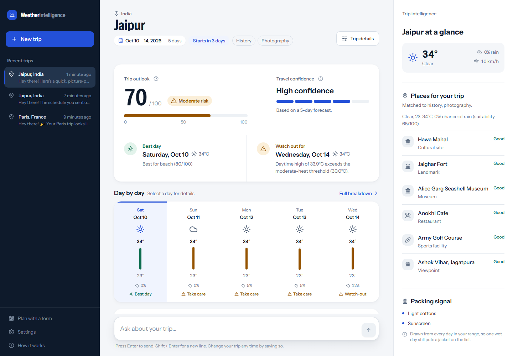

---

## Table of Contents

- [Overview](#overview)
- [Key Features](#key-features)
- [Product Walkthrough](#product-walkthrough)
- [How a Message Flows](#how-a-message-flows)
- [System Architecture](#system-architecture)
- [Technology Stack](#technology-stack)
- [Project Structure](#project-structure)
- [Getting Started](#getting-started)
- [Configuration](#configuration)
- [API Overview](#api-overview)
- [Testing](#testing)
- [Forecast and Data Limitations](#forecast-and-data-limitations)
- [Design and UX](#design-and-ux)
- [Documentation](#documentation)
- [Known Limitations](#known-limitations)
- [Future Improvements](#future-improvements)
- [Contributing](#contributing)
- [License](#license)

---

## Overview

Weather apps answer *"what will the weather be?"*. Travellers usually need *"is this a good trip, and how should I plan it?"*. Weather Intelligence closes that gap.

You write something like *"Plan a 5 day trip to Jaipur from October 10 to October 14. I like history and photography."* The service:

1. understands the destination, dates, trip length and interests;
2. fetches the forecast for those dates;
3. scores the trip with a deterministic rule engine (suitability, risk, confidence, best and worst day);
4. looks up real nearby places on OpenStreetMap;
5. writes a conversational answer grounded in those results.

**Who it's for:** anyone planning a short trip who wants to know which days to use for what, and developers interested in a layered FastAPI + React design where an LLM explains computed results instead of producing them.

**Design principle:** every number on screen (scores, risk levels, temperatures, rain chances, best and worst days) comes from the deterministic engine or a real data source. The LLM is used for two things only: reading the user's message and writing the reply.

---

## Key Features

### Travel planning
- **Natural-language trip setup.** Destination, start and end dates, trip length, interests, travel style and pace are extracted from free text.
- **Persistent trip context.** Details carry across turns: a trip length given before the dates is kept, and a lone date answering "when does your trip end?" becomes the end date.
- **Destination help.** Ambiguous names (e.g. "Paris") return a numbered list to choose from. Users without a destination get 3–4 suggestions, each verified against the geocoder before it is shown.
- **Follow-up questions.** "What if it rains?", "What should I pack?" and "Which day is best?" are answered against the same trip.

### Weather intelligence
- **Trip outlook.** A 0–100 suitability score, an overall risk level and a travel-confidence rating.
- **Best day and watch-out day,** each with the engine's reason (for example *"Daytime high of 38.3 °C exceeds the high-heat threshold"*).
- **Day-by-day forecast.** High and low temperature, chance of rain, wind, conditions and a per-day travel advisory.
- **Multi-provider forecasts.** Open-Meteo is the primary source; OpenWeather and WeatherAPI are configured fallbacks.

### Risk analysis
- Rule-based risk factors per day (heat, cold, rain and wind) with severity levels, driven by a versioned rule configuration (`app/infrastructure/config/rule_config/2026.07.yaml`).
- A confidence score that drops for days further ahead, when sources disagree, or when data is missing.

### Personalised insights
- Activity suitability scores per day (beach, sightseeing, museum…), used to explain why a day is best.
- Real places from OpenStreetMap, ranked against the trip's interests and each day's weather, each linked to Google Maps.
- Packing recommendations derived from the whole forecast.

### Frontend experience
- **Trip workspace.** The trip header, outlook, best and watch-out days, forecast ribbon and selected-day detail sit above the conversation.
- **Right-hand intelligence panel.** "At a glance" weather for the selected day, places for the trip and a packing signal.
- **Conversation history.** Past trips are stored server-side and restorable from the sidebar.
- **Full breakdown page** with an AI explanation, daily timeline, packing checklist and raw normalized readings.
- **Manual planner.** Pick a destination and dates from a form instead of chatting.

### Frontend-only UX features
These are implemented entirely in the browser:
- explanatory tooltips on the trip outlook and travel confidence;
- a "Trip details" dialog listing everything the assistant has understood;
- example prompts on the empty state, and follow-up suggestion chips after each answer;
- a trip countdown ("Starts in 4 days") computed from the dates;
- loading skeletons shaped like the dashboard, plus clear error and "too early to forecast" states;
- keyboard navigation of the forecast ribbon (arrow keys), visible focus, and a skip link;
- settings for °C / °F and reduced motion;
- responsive layouts for desktop, tablet and phone.

---

## Product Walkthrough

Every screenshot below is from the running application, using the real backend, weather providers, places service and LLM. They follow one trip from start to finish:

> **"Plan a 5 day trip to Jaipur from October 10 to October 14. I like history and photography."**

### 1. Start with a plain-language request

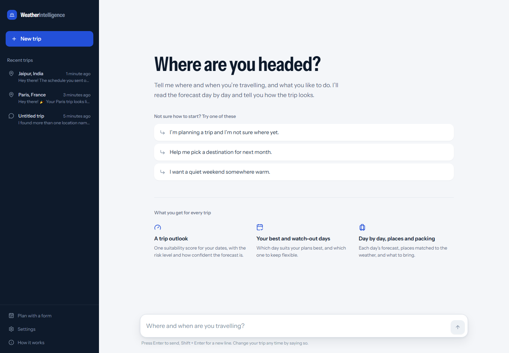

The app opens straight into the conversation. Example prompts help first-time users get started, and picking one fills the input without sending it. "What you get for every trip" explains the output up front. The left sidebar holds recent trips, a **New trip** button, the manual planner and Settings.

### 2. The assistant understands the trip

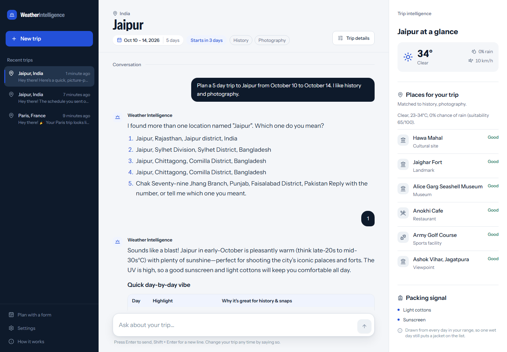

"Jaipur" matches several places, so the assistant asks which one is meant instead of guessing. Replying **1** keeps everything else from the first message (dates, trip length and interests), and the trip is planned.

### 3. The trip dashboard


Once the trip is understood, it becomes a workspace:

- **Header:** destination, dates, trip length, a countdown and the detected interests.
- **Trip outlook and the two key days:** suitability, risk, confidence, and the best and watch-out days.
- **Day by day:** a forecast ribbon. Each day's high-to-low bar is drawn on a scale shared across the whole trip, so warmer and cooler days stand out at a glance.
- **Right panel:** the selected day at a glance, places for the trip and the packing signal.

### 4. Risk and travel intelligence

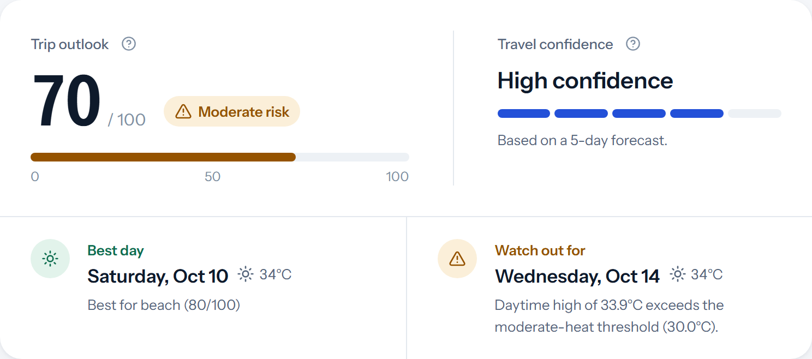

- **Score:** sits on its 0–100 scale next to the overall risk level.
- **Travel confidence:** shows how far to trust the outlook.
- **Best day:** says what the day is best suited to.
- **Watch-out day:** carries the exact rule that flagged it, here *"Daytime high of 33.9 °C exceeds the moderate-heat threshold (30.0 °C)"*.

Risk states use an icon and a word as well as a colour.

### 5. Weather, day by day

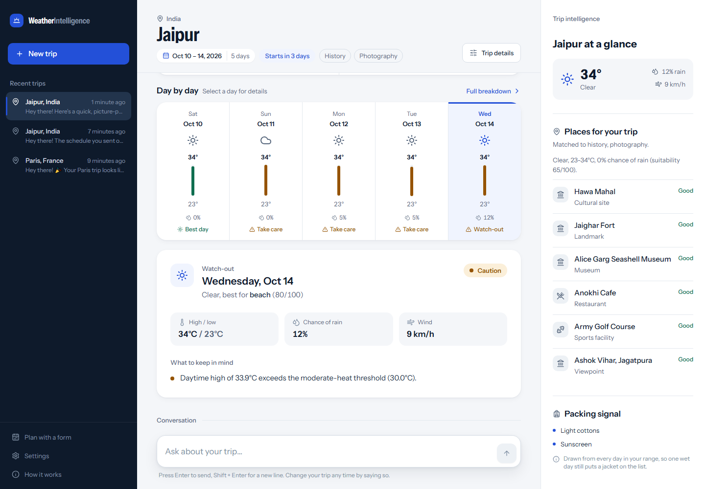

Selecting a day in the ribbon opens its detail: conditions, the activity it suits best, high and low temperature, chance of rain, wind, the day's travel advisory, and the risk factors behind it. The right panel follows the selection.

### 6. Places to visit

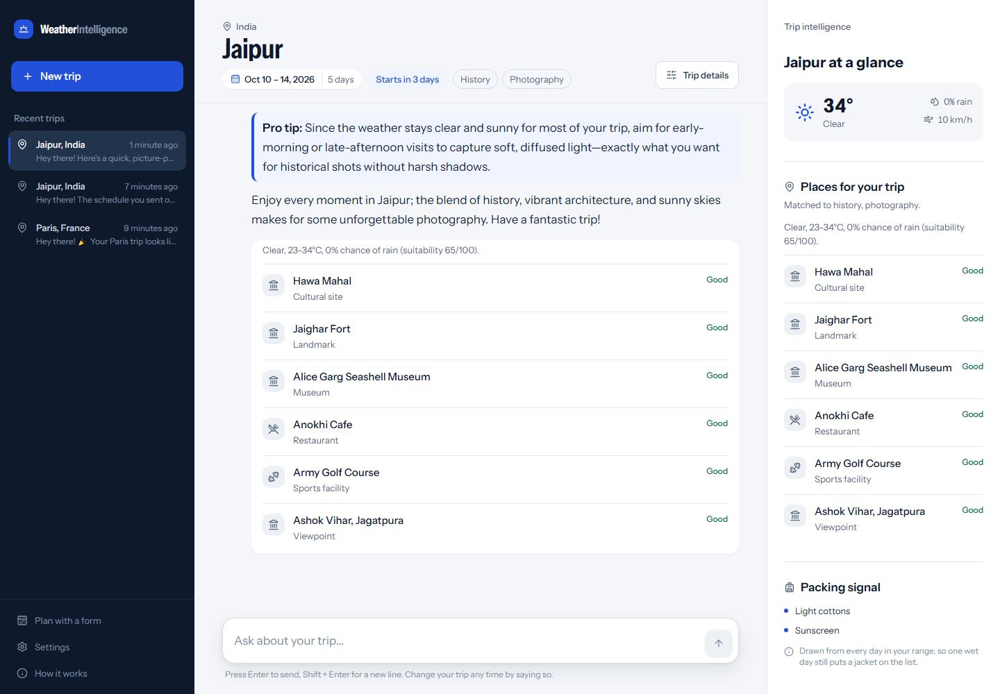

Asking *"What are some places to visit and things to do there?"* searches OpenStreetMap around the destination. Places are matched to the trip's interests and rated against each day's weather. Every entry links to its location on Google Maps.

### 7. The intelligence panel

<p align="center">
  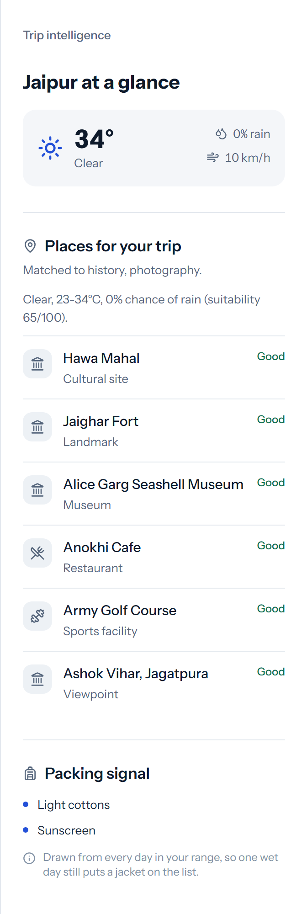
</p>

The right-hand panel stays with the trip for the whole conversation:

- **At a glance:** the selected day's weather.
- **Places for your trip:** the latest places found, with their weather suitability.
- **Packing signal:** drawn from every day of the trip.

On smaller screens it opens as a slide-in sheet.

### 8. Destination suggestions

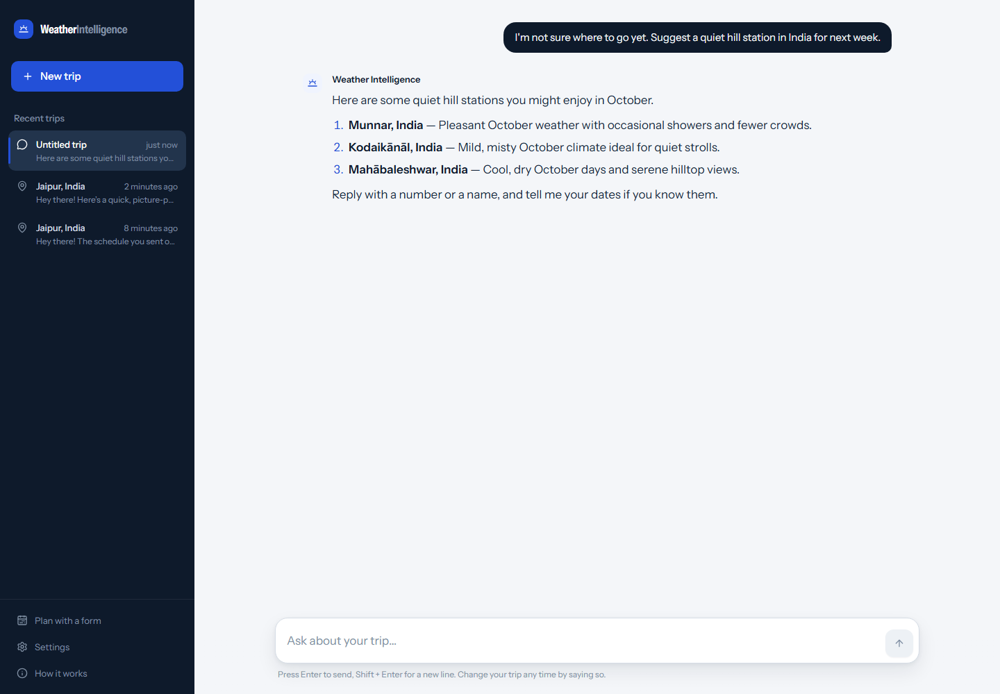

Users without a destination can ask for ideas. Each suggestion is checked against the geocoder before it is offered, and replying with a number or a name continues straight into planning.

### 9. Built-in help

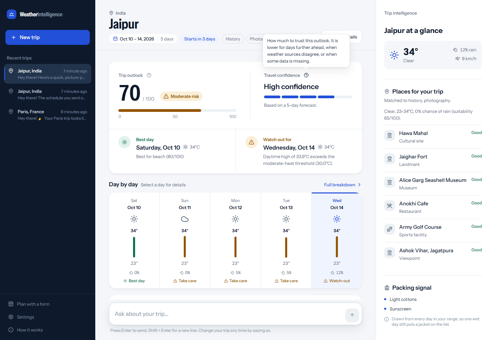

Help icons explain the trip outlook and travel confidence in plain language.

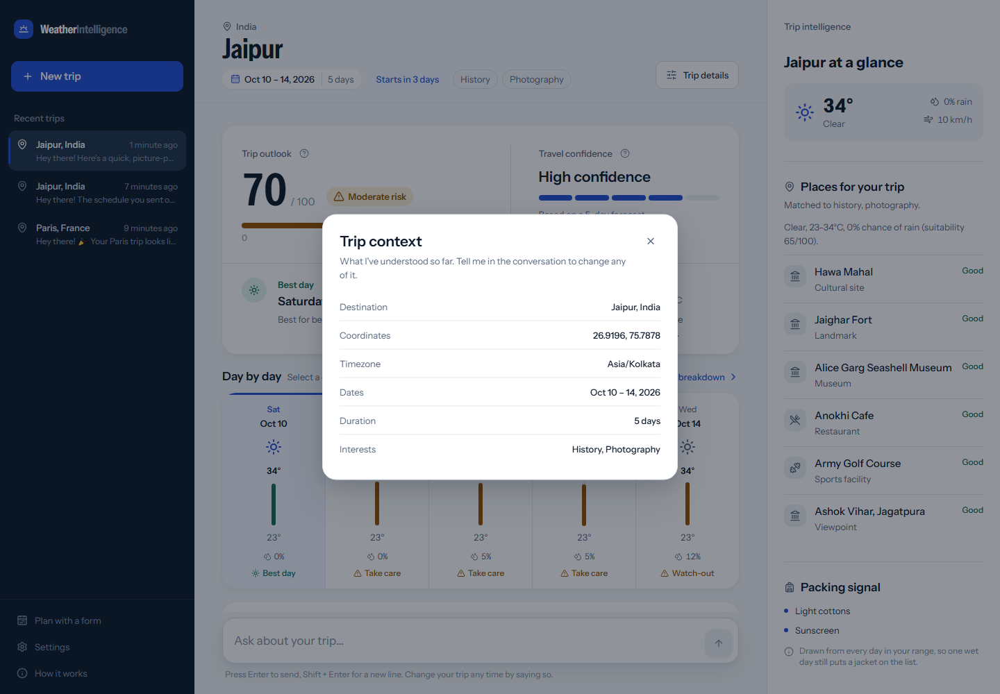

**Trip details** lists everything the assistant currently understands: destination, coordinates, timezone, dates, duration and interests. To change any of it, the user says so in the conversation.

### 10. Full breakdown

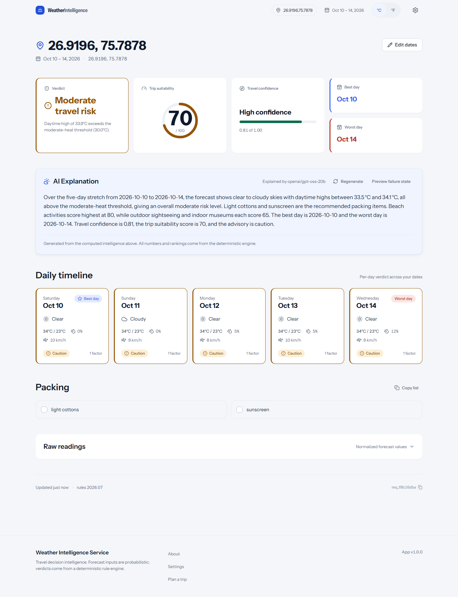

**Full breakdown** opens a dedicated page for the same trip:

- the verdict, the suitability gauge and travel confidence;
- an AI explanation of the computed results, which can be regenerated;
- a daily timeline;
- a packing checklist with copy-to-clipboard;
- the raw normalized forecast readings.

### 11. Manual planner

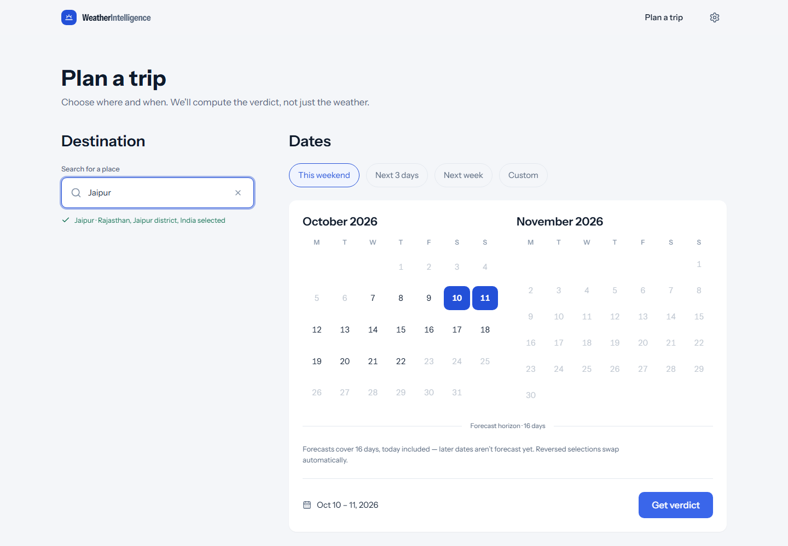

A form-based alternative to chatting: search for a destination, pick dates from presets or a calendar limited to the forecast window, and select **Get verdict**.

### 12. On a phone

<p align="center">
  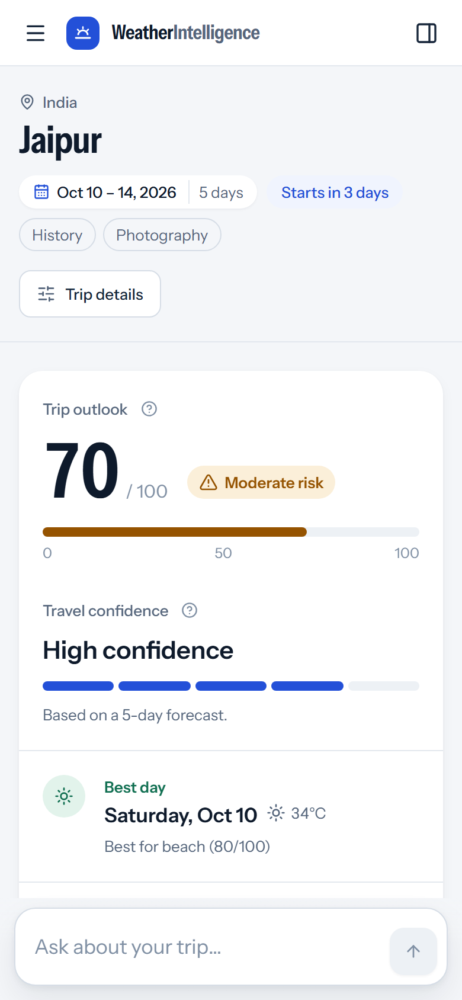
</p>

On small screens the sidebar and the intelligence panel become slide-in sheets, and the forecast ribbon scrolls sideways within its own band.

---

## How a Message Flows

```
User message
    ↓
Trip understanding        LLM extracts destination, dates, length, interests, intent
    ↓                     (deterministic fallback parser if the LLM is unavailable)
Location & dates          Geocoding; ambiguous names → disambiguation; date checks
    ↓
Forecast window           Days within the provider's forecast window are analysed;
    ↓                     later days are reported as "not forecast yet"
Weather retrieval         Open-Meteo, with OpenWeather / WeatherAPI fallbacks
    ↓
Intelligence engine       Score, risk, confidence, best / worst day, activities, packing
    ↓
Places                    OpenStreetMap Overpass, ranked by interests and weather
    ↓
Answer                    LLM writes the reply from the computed data
    ↓                     (structured summary if the LLM is unavailable)
Persistence               Conversation + trip state saved in PostgreSQL
    ↓
Interactive dashboard     The frontend renders the reply and the trip workspace
```

---

## System Architecture

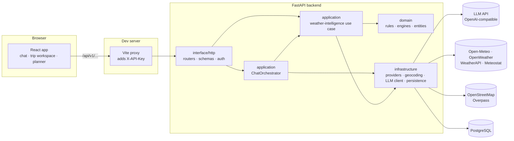

- **Layered backend.** `domain` has no framework imports; `application` holds the use cases; `infrastructure` talks to the outside world; `interface/http` exposes the API. The boundaries are enforced in CI by `import-linter` (`setup.cfg`).
- **One orchestrator, two LLM calls per turn.** One call reads the message, one writes the answer. There is no agent loop and no autonomous tool calling.
- **The API key never reaches the browser.** The frontend calls a same-origin `/api` path, and the Vite dev proxy adds `X-API-Key` server-side.

---

## Technology Stack

| Layer | Technologies |
|---|---|
| **Frontend** | React 19, TypeScript, Vite, Tailwind CSS 4, TanStack Query, React Router, Radix UI, react-markdown, Zod, Instrument Sans |
| **Backend** | Python 3.11+, FastAPI, Pydantic / pydantic-settings, SQLAlchemy 2 (async), Alembic, httpx, tenacity, structlog, Jinja2 |
| **API** | REST + JSON envelope, OpenAPI schema (frontend types generated with `openapi-typescript`), API-key auth |
| **AI / LLM** | Any OpenAI-compatible chat-completions API; developed against Groq (`openai/gpt-oss-20b`) |
| **Weather & geo** | Open-Meteo (forecast + geocoding), OpenWeather, WeatherAPI, Meteostat, OpenStreetMap Overpass |
| **Database** | PostgreSQL 15 (asyncpg); Redis 7 in Docker Compose (the app can also run with `CACHE_BACKEND=memory`) |
| **Testing & quality** | pytest, pytest-asyncio, respx, Testcontainers, ruff, mypy (strict), import-linter, Vitest, ESLint, Prettier |
| **DevOps** | Docker, Docker Compose, GitHub Actions |

---

## Project Structure

```
.
├── app/                        Backend (FastAPI)
│   ├── domain/                   Entities, rules, scoring/risk/recommendation engines, ports
│   ├── application/              Use cases: chat orchestration, weather intelligence
│   ├── infrastructure/           Weather providers, geocoding, places, LLM client,
│   │                             persistence, config (incl. versioned rule config)
│   ├── interface/http/           Routers, request/response schemas, auth, error mapping
│   └── main.py                   Application factory
├── migrations/                 Alembic migrations (locations, readings, daily intelligence, conversations)
├── tests/                      Backend tests, grouped by layer; tests/live is opt-in
├── frontend/                   React app
│   ├── src/features/             chat · planner · dashboard · settings · about
│   ├── src/components/           UI primitives, layout, feedback states, weather widgets
│   ├── src/services/api/         Typed API client and error handling
│   ├── src/styles/               Design tokens and global styles
│   └── vite.config.ts            Dev server + API proxy that injects the key
├── docs/                       Architecture, API contract, design docs, screenshots
├── docker/                     Backend Dockerfile
├── docker-compose.yml          PostgreSQL, Redis and the API
└── .github/workflows/ci.yml    Backend and frontend CI
```

---

## Getting Started

### Prerequisites

| Tool | Version |
|---|---|
| Python | 3.11 or newer |
| Node.js | 20 or newer (CI uses 20) |
| Docker | For PostgreSQL and Redis via Docker Compose |
| LLM API key | Any OpenAI-compatible provider (e.g. Groq) |

Weather data from Open-Meteo needs no key. OpenWeather, WeatherAPI and Meteostat keys are optional.

### Clone

```bash
git clone https://github.com/rniyati07/weather-intelligence.git
cd weather-intelligence
```

### Start the database

```bash
docker compose up -d postgres redis
```

### Backend setup

```bash
python -m venv .venv
source .venv/bin/activate            # Windows: .venv\Scripts\activate
pip install -e ".[dev]"

cp .env.example .env                 # then set LLM_API_KEY (and anything else you need)
alembic upgrade head
```

### Frontend setup

```bash
cd frontend
npm ci
cp .env.example .env.local           # set API_KEY to one of the values in API_KEYS (backend .env)
```

### Running the application

Run these in two terminals:

```bash
# Terminal 1 — backend, from the repository root
python -m uvicorn app.main:app --reload
```

```bash
# Terminal 2 — frontend, from frontend/
npm run dev
```

| Service | URL |
|---|---|
| Web app | <http://localhost:5173> (Vite picks the next free port if it is taken) |
| API | <http://127.0.0.1:8000> |
| Interactive API docs | <http://127.0.0.1:8000/docs> |
| Health check | <http://127.0.0.1:8000/health> → `{"status":"ok"}` |

Restart `npm run dev` after editing `frontend/.env.local`; Vite reads it only at startup.

---

## Configuration

Real values live in `.env` (backend) and `frontend/.env.local` (frontend). Both files are git-ignored; the committed `.env.example` files list every variable with placeholders. Never commit real keys.

### Backend (`.env`)

| Variable | Required | Purpose |
|---|---|---|
| `API_KEYS` | ✔ | Comma-separated keys accepted in the `X-API-Key` header |
| `OPS_API_KEYS` | | Keys for operator-only endpoints (`/providers/health`) |
| `DATABASE_URL` | ✔ | PostgreSQL connection (`postgresql+asyncpg://…`) |
| `LLM_API_KEY` | ✔ | Key for the LLM provider |
| `LLM_MODEL` | ✔ | Model name, e.g. `openai/gpt-oss-20b` |
| `LLM_BASE_URL` | ✔ | OpenAI-compatible base URL, e.g. `https://api.groq.com/openai/v1` |
| `LLM_TIMEOUT_SECONDS`, `LLM_MAX_OUTPUT_TOKENS` | | LLM request limits |
| `LLM_REASONING_EFFORT` | | Optional `low`/`medium`/`high` for reasoning models (unset by default) |
| `OPENWEATHER_API_KEY`, `WEATHERAPI_KEY`, `METEOSTAT_API_KEY` | | Optional extra weather providers |
| `PROVIDER_PRIORITY_FORECAST` | | Provider order, default `open_meteo,openweather,weatherapi` |
| `REDIS_URL`, `CACHE_BACKEND` | | Cache settings; `CACHE_BACKEND=memory` runs without Redis |
| `MAX_FORECAST_HORIZON_DAYS` | | Forecast window in days, including today (default `16`) |
| `RULE_CONFIG_VERSION` | | Which rule configuration file the engine loads |
| `LOG_LEVEL`, `LOG_FORMAT` | | Logging |

### Frontend (`frontend/.env.local`)

| Variable | Purpose |
|---|---|
| `API_KEY` | Sent as `X-API-Key` by the dev proxy. Server-side only, never bundled |
| `OPS_API_KEY` | Used by the proxy for operator routes |
| `API_PROXY_TARGET` | Backend URL the proxy forwards to (default `http://localhost:8000`) |
| `VITE_API_BASE_URL` | Path the browser calls (default `/api/v1`) |
| `VITE_API_TIMEOUT_MS` | Request timeout; chat turns can take a while, 60000 is recommended |
| `VITE_APP_VERSION`, `VITE_ENABLE_QUERY_DEVTOOLS` | Display version and dev tooling |

Only `VITE_*` values reach the browser, and none of them is a secret.

---

## API Overview

All endpoints except `/health` require the `X-API-Key` header and are served under `/api/v1`. Responses use a common envelope: `{ success, data, metadata, error }`. The full, current schema is at `/docs` and `/openapi.json`.

| Method | Endpoint | Purpose |
|---|---|---|
| `GET` | `/health` | Liveness probe (no auth) |
| `POST` | `/api/v1/conversations/chat` | Send a message; returns the reply, trip context, places and any destination candidates |
| `POST` | `/api/v1/conversations` | Create a conversation, optionally with a first message |
| `GET` | `/api/v1/conversations` | List conversations |
| `GET` | `/api/v1/conversations/{conversation_id}` | Get a conversation with its messages and trip context |
| `GET` | `/api/v1/locations/{location_id}/intelligence` | Full weather intelligence for `startDate`–`endDate` |
| `GET` | `/api/v1/locations/{location_id}/intelligence/best-days` | Best and worst days for a date range |
| `GET` | `/api/v1/locations/{location_id}/intelligence/packing` | Packing recommendations for a date range |
| `POST` | `/api/v1/locations/{location_id}/intelligence/narrative` | AI explanation of the computed intelligence |
| `GET` | `/api/v1/locations/{location_id}/weather/raw` | Normalized raw readings from the providers |
| `GET` | `/api/v1/providers/health` | Weather-provider status (requires an operator key) |

`location_id` is `"{lat},{lon}"` with four decimal places, e.g. `26.9196,75.7878`.

```bash
curl -H "X-API-Key: <your key>" \
  "http://127.0.0.1:8000/api/v1/locations/26.9196,75.7878/intelligence?startDate=2026-10-10&endDate=2026-10-14"
```

---

## Testing

```bash
# Backend — from the repository root, virtualenv active
pytest                   # unit + API tests; external services are faked
ruff check .             # lint
mypy app                 # strict type checking
lint-imports             # architecture layer boundaries

# Frontend — from frontend/
npm test                 # Vitest unit tests
npm run typecheck
npm run lint
npm run format:check
npm run build
```

- **Integration tests** that need Docker (Testcontainers) skip themselves when it isn't available.
- **Live tests** in `tests/live/` call the real LLM, weather and Overpass services and are excluded by default. Run them with `pytest -m live tests/live` once `.env` holds real credentials; see [tests/live/README.md](tests/live/README.md).
- **CI** runs every check above on each push and pull request ([.github/workflows/ci.yml](.github/workflows/ci.yml)).

At the last local run: backend 660 passed (19 skipped without Docker, 3 live tests deselected), frontend 39 passed; lint, type checks and the production build were clean.

---

## Forecast and Data Limitations

- **Forecast window.** Open-Meteo serves forecasts from today through **today + 15 days** (16 days including today) and rejects later dates. There is **no limit on trip length**:
  - a trip that runs past the window is saved in full;
  - the days inside the window get a complete analysis;
  - the reply and the dashboard name the dates that are not forecast yet;
  - a trip starting beyond the window is saved, with a note on when forecasts become available.

  `MAX_FORECAST_HORIZON_DAYS` mirrors this provider limit.
- **Forecast-only.** Date ranges entirely in the past are rejected; there is no historical mode in the chat or dashboard.
- **Accuracy falls off with distance.** Travel confidence is lower for days further ahead, which is why it is shown next to every outlook.

---

## Design and UX

- **Decision first.** The dashboard leads with the verdict (score, risk, confidence), then the two days that should shape the plan, then the detail. The conversation sits below, as supporting explanation.
- **Meaning never depends on colour alone.** Every risk and day state pairs its colour with an icon and a word.
- **One visual system.** Design tokens in `frontend/src/styles/tokens.css` define a cool, high-contrast palette: navy ink, a single cobalt accent, and functional green, amber and red for risk. A single typeface (Instrument Sans) uses its condensed width for display moments.
- **Accessible by default.** Radix primitives for dialogs and tooltips, visible keyboard focus, a skip link, `rem`-based type, and respect for reduced-motion preferences.
- **Honest states.** Loading skeletons mirror the real layout, errors say what happened and offer a retry, and a degraded LLM answer is labelled "Structured summary".

---

## Documentation

| Topic | Document |
|---|---|
| Index of all documents | [docs/README.md](docs/README.md) |
| Current system specification (incl. chat flow) | [docs/architecture/system-specification.md](docs/architecture/system-specification.md) |
| Technical design of the intelligence engine | [docs/architecture/technical-design.md](docs/architecture/technical-design.md) |
| Original architecture decisions | [docs/architecture/system-architecture-original.md](docs/architecture/system-architecture-original.md) |
| Weather-intelligence API contract | [docs/api/api-and-data-contract.md](docs/api/api-and-data-contract.md) |
| Product requirements (original scope) | [docs/product/product-requirements.md](docs/product/product-requirements.md) |
| Implementation guide | [docs/development/implementation-guide.md](docs/development/implementation-guide.md) |
| Frontend architecture and conventions | [frontend/README.md](frontend/README.md) |

---

## Known Limitations

- **Place results depend on the public Overpass server,** which can be slow or return gateway timeouts and rate limits. When it does, the places section stays empty for that turn and suggests asking again.
- **Region names resolve to a centre point.** A state or region (for example "Goa") is geocoded to its geographic centre, which may have no attractions nearby. City names give the best place results.
- **Activity scores are weather-based.** Activity suitability (beach, sightseeing, museum) is scored from the forecast alone, not from what exists at the destination, so an inland city can still show a high beach score.
- **LLM rate limits.** Free LLM tiers cap tokens per minute. Under a burst of messages the backend waits and retries once. Otherwise it falls back to a deterministic parser and a structured summary rather than failing.
- **LLM wording.** Answers are written from computed data, but the model may still add general knowledge (for example, well-known sights) or small slips such as a wrong weekday. The dashboard figures are authoritative.
- **Geocoder naming.** Destinations come from the Open-Meteo gazetteer, which occasionally prefers an unusual entry (for example an airport) for a well-known town.
- **Full breakdown title.** Opened from a chat trip, the breakdown page is titled with the coordinates rather than the destination name.
- **Production deployment.** The Vite proxy is a development convenience. Production needs a server-side layer that injects `X-API-Key` the same way.
- **Docker.** `docker-compose.yml` and `docker/Dockerfile` describe the full backend stack, but building and running the image has not been verified in every environment.

---

## Future Improvements

- A production backend-for-frontend to replace the development proxy
- Clickable choices for destination candidates and suggestions (today they are answered by typing a number or a name)
- A theme switch in Settings for the existing dark palette
- Component and end-to-end browser tests for the frontend
- Additional narration languages (the setting exists; English is the only option today)

---

## Contributing

1. Fork the repository and create a branch: `git checkout -b feature/your-change`.
2. Keep to the existing layering: domain code stays free of framework imports, and frontend features don't import from each other.
3. Run the checks in [Testing](#testing) for the side you changed; CI runs the same set.
4. Open a pull request describing what changed and why.

---

## License

Released under the [MIT License](LICENSE).
